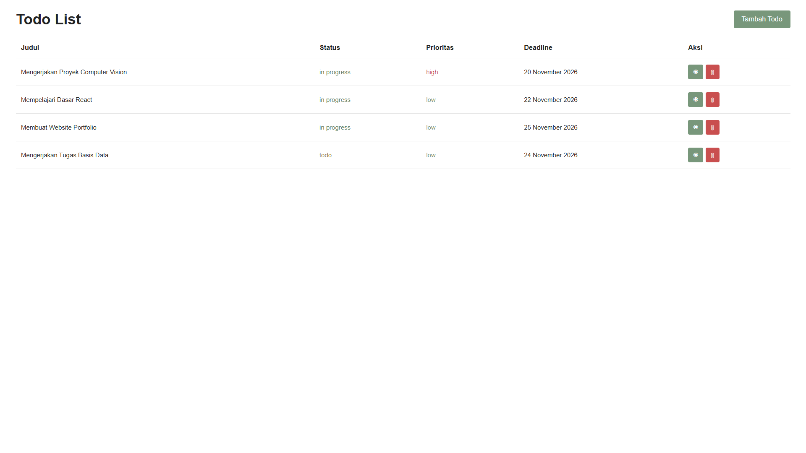
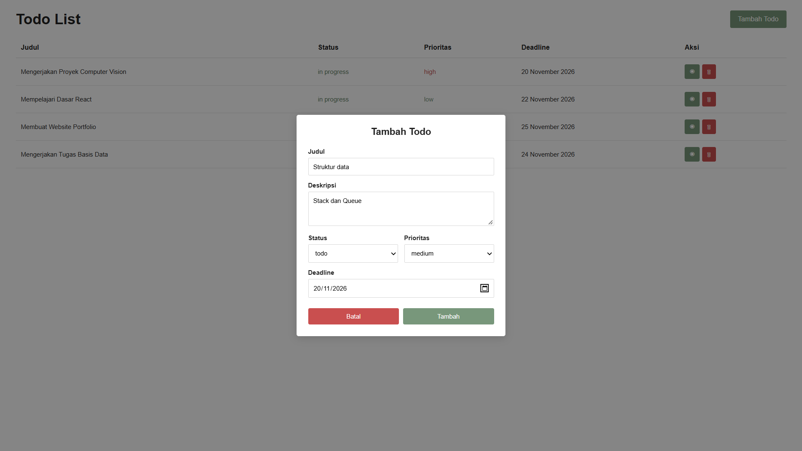
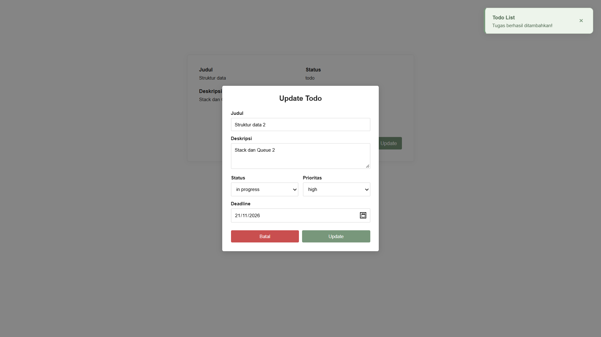
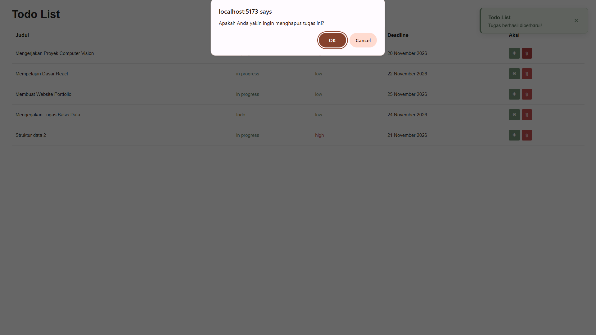
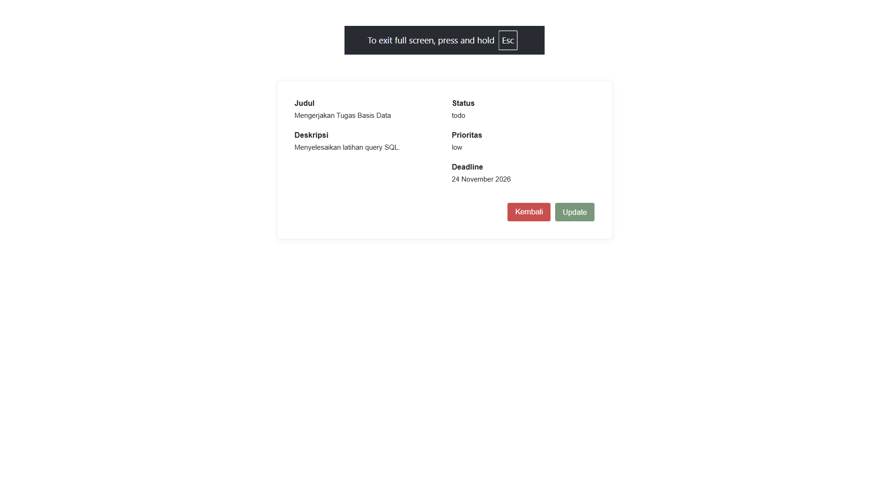

# Aplikasi Todo List React

## Deskripsi
Aplikasi Todo List berbasis React.js untuk menampilkan dan mengelola daftar tugas.

## Fitur Aplikasi

- Menampilkan daftar tugas
- Menambahkan tugas
- Memperbarui tugas
- Menghapus tugas
- Melihat detail tugas

## Screenshot Implementasi

### Menampilkan Tugas

### Menambahkan Tugas

### Memperbarui Tugas

### Menghapus Tugas

### Melihat Detail Tugas

